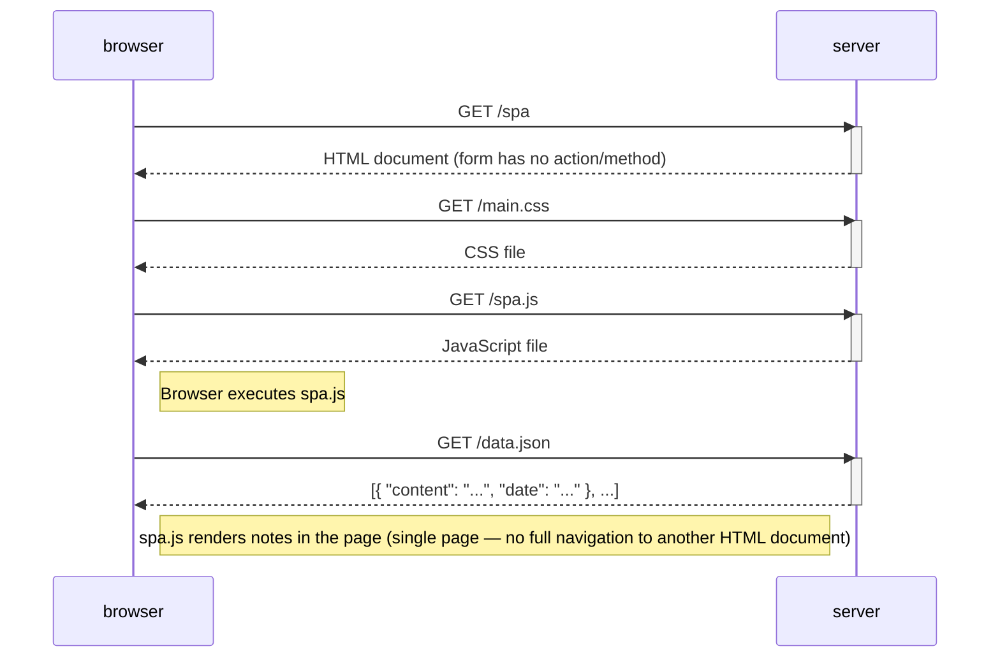

# 0.5: SPA diagram (loading and using `/spa`)

Exercise 0.5 — user opens and uses the single-page version at https://studies.cs.helsinki.fi/exampleapp/spa.

Initial load is similar to `/notes`, but the script is `spa.js` and the page is not re-fetched when notes are updated later.

