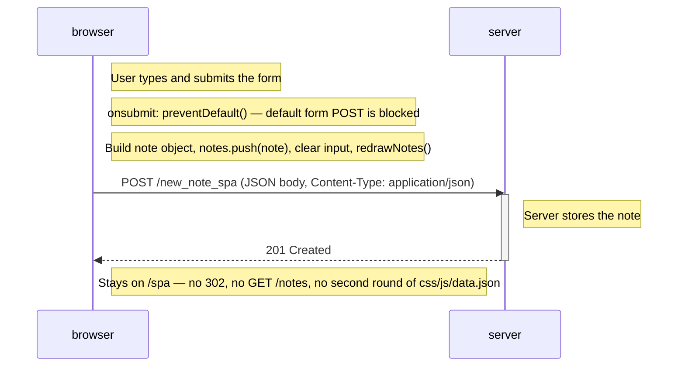

# 0.6: New note in the SPA diagram

Exercise 0.6 — user creates a note on https://studies.cs.helsinki.fi/exampleapp/spa.

JavaScript intercepts submit (`preventDefault`), updates the UI locally, and sends one POST with JSON. No redirect and no page reload.

